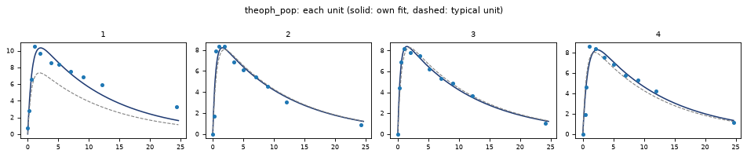

# Results

`tf.fit` returns a result. This page goes through what it holds, with the theophylline fit of
the [population quickstart](../start/quickstart-population.md) as the example
(`method laplace`; an `optimize` fit has the same parts, without the per-unit ones).

```python
import tenqsp_fit as tf

result = tf.fit(tf.load("theoph_pop.tq"))
print(result)
```

```text
theoph_pop: method laplace (BFGS, FOCE-I), converged; -2LL 353.9837 (132 measurements, 12 units)
starts: 1; 1 at the best fit (within 0.1); redrawn 0; failed runs during the fit 0; 41 s

quantity                  estimate         SE  RSE %   95 % CI                 also
ka.median                   1.6195     0.3207   19.8   (1.099, 2.388)
ka.sdlog                   0.65643       0.15   22.9   (0.4194, 1.027)         cv 73.4 %, var 0.4309
CL.median                 0.039544   0.002353   5.95   (0.03519, 0.04444)
CL.sdlog                   0.16751    0.03643   21.7   (0.1094, 0.2566)        cv 16.9 %, var 0.02806
ke                        0.084964   0.004342   5.11   (0.07687, 0.09392)
conc.additive              0.70777    0.04815    6.8   (0.6194, 0.8087)

shrinkage (1 - SD of the units' scores): ka 0.8 %, CL -0.7 %

doctor: 3 notes
note     determination: condition number of the curvature 39.1; no ridge, every quantity determined within a factor 10.
note     optima: one start: other optima were not looked for.
         what to do: options starts=8 looks from 8 starts.
note     tolerance check: at rtol 1e-08 the -2LL changes by 2.2e-05 and the estimates by less than 0.001 SE; rtol 1e-06 is enough.
```

## The printout, line by line

**The first line**: the problem's name, the method and the optimizer that ran it, the
status, −2LL, and how many measurements (and units) it is based on.

| Status | Means |
|---|---|
| `converged` | the optimizer's stopping rule was met |
| `max iterations` | the step limit (`options maxiter`, 200 by default) was reached first: the estimates are where it stopped, and the doctor says so as a problem |
| `stopped` | Ctrl-C or `options timeout` stopped it: no standard errors (see [running a fit](running.md)) |
| `failed` | no start ended with a finite −2LL |

**−2LL** is minus twice the log-likelihood, including the constant n log 2π for the n
measured values. NONMEM's objective function value leaves that constant out: OFV = −2LL −
n log 2π. Monolix reports −2LL with it. The constant does not depend on the parameters, so it
changes no estimate, standard error or likelihood-ratio test on the same data.

**The second line**: how many starts ran and how many ended within 0.1 of the best −2LL
(the same optimum); how many starts were drawn again because the model did not run at them;
how many runs of the model failed during the fit (a step the optimizer had to refuse); the
time of the optimization (preparing the model before it and the doctor's checks after it are
not counted).

**The table**: one row per estimated quantity.

| Column | Means |
|---|---|
| `quantity` | the name: a parameter (`ke`), a distribution's parameter (`ka.median`, `ka.sdlog`), or an error model's (`conc.additive`) |
| `estimate` | the value at the best fit |
| `SE` | the standard error, from the curvature of −2LL at the estimates (NONMEM's covariance step, the R matrix) |
| `RSE %` | 100 × SE / \|estimate\| |
| `95 % CI` | the 95 % interval, symmetric on the scale the quantity was estimated on: on the log scale for a positive quantity, so it stays positive and is not symmetric around the estimate |
| `also` | a spread in its other usual forms: for a lognormal's `sdlog`, the CV and the variance (NONMEM's OMEGA); `at its lower bound` for an estimate at a bound |

The scale of each quantity is listed by `problem.summary()` (`scales`).

**An estimate at a bound** written for it (`estimate k = 0.3 in (0.01, 0.4)`; within 1 % of
the interval's width) has no standard error or interval: the curvature there does not describe
it, and a likelihood-ratio test against a value on the bound does not follow the usual
chi-square. The other quantities' standard errors are computed with it held at the bound, as
if it were fixed there. The doctor warns about it. Report such an estimate as "at the bound",
and use a [profile](#profile-likelihood) for what the data say about it.

**Shrinkage** (with parameters that vary between units): 1 minus the SD of the units' normal
scores, per varying parameter. Near 0, each unit's own values are informed by its own data;
above 30 % the doctor warns that plots of the units' values are unreliable.

**The doctor**: its findings, most severe first. See [the doctor](doctor.md).

When the standard errors could not be computed, a line under the table says why, and the SE,
RSE and interval columns are empty. A `note:` line under the table reports a start that the
`laplace` optimizer ended early, with its reason.

## The same, as data

| | What it is |
|---|---|
| `result.estimates` | `{name: value}` |
| `result.table()` | the table above as a pandas DataFrame (columns `quantity`, `estimate`, `SE`, `RSE %`, `CI 2.5 %`, `CI 97.5 %`, `also`, and `bound`: `lower`, `upper` or empty) |
| `result.se`, `result.cov` | standard errors, and the covariance matrix of the estimates |
| `result.corr` | the correlations of the estimates, one row and column per quantity (after `nuts`, over the draws); the passport adds the eigenvalues of this matrix, as NONMEM's `$COV PRINT=E` |
| `result.m2ll`, `result.status` | −2LL and the status |
| `result.covariance_status` | `"ok"`, or why there are no standard errors |
| `result.shrinkage` | `{parameter: shrinkage}` (`laplace`) |
| `result.starts` | one row per start: its −2LL, steps, status, where it started and where it ended |
| `result.trace` | every step of every start: start, iteration, −2LL and the values |
| `result.doctor()` | the doctor's findings (`.table()` as a DataFrame) |
| `result.model()` | the TenQSP model with the fitted values in (below) |

```python
result.table()
```

```text
        quantity  estimate        SE      RSE %  CI 2.5 %  CI 97.5 %                    also
0      ka.median  1.619518  0.320713  19.802978  1.098549   2.387548
1       ka.sdlog  0.656425  0.150018  22.853720  0.419421   1.027354   cv 73.4 %, var 0.4309
2      CL.median  0.039544  0.002353   5.950846  0.035190   0.044436
3       CL.sdlog  0.167511  0.036433  21.749586  0.109372   0.256554  cv 16.9 %, var 0.02806
4             ke  0.084964  0.004342   5.110862  0.076865   0.093916
5  conc.additive  0.707770  0.048153   6.803514  0.619412   0.808733
```

With several starts, `result.starts` shows where each began and ended. From a small `optimize`
fit with `options starts=4 seed=1`:

```text
   start       -2LL  steps     status  k (start)  amount.proportional (start)         k  amount.proportional
0      1 -47.428993     50  converged   0.300000                     0.100000  0.491087             0.045597
1      2 -47.428993     37  converged   0.396185                     0.193706  0.491087             0.045597
2      3 -47.428993     56  converged   0.391385                     0.035040  0.491087             0.045597
3      4 -47.428993     68  converged   0.621627                     0.143219  0.491087             0.045597
```

Start 1 is the values written in the problem; the others are drawn around them with the
`seed` (see [running a fit](running.md#options)).

## Each unit

With parameters that vary between units, `result.individual()` gives each unit's normal
scores (NONMEM's ETAs divided by their SD; the conditional modes, NONMEM's EBEs) and its
values:

```text
   unit     z(ka)     z(CL)        ka        CL        ke
0     1 -0.195645 -2.137339  1.424331  0.027643  0.084964
1     2  0.418646  0.043821  2.131740  0.039835  0.084964
2     3  0.545603  0.141746  2.317006  0.040494  0.084964
```

After `method optimize` there are no per-unit values: one set fits all, and
`result.individual()` says so.

## NONMEM-style tables

`result.tables()` returns two DataFrames, `{"sdtab": ..., "patab": ...}`; `result.tables("folder")` also writes them as CSV.

**sdtab**, one row per measurement:

```text
   ID  TIME  link     DV      PRED      IPRED     IWRES  CENS  LIMIT
0   1  0.00  conc   0.74  0.000000   0.000000  1.045537     0    NaN
1   1  0.25  conc   2.84  2.843413   3.660303 -1.158996     0    NaN
2   1  0.57  conc   6.57  5.063290   6.684125 -0.161246     0    NaN
3   1  1.12  conc  10.50  6.802147   9.281487  1.721621     0    NaN
4   1  2.02  conc   9.66  7.332101  10.327774 -0.943489     0    NaN
```

| Column | Means |
|---|---|
| `ID` | the unit (the column named in `unit`; `unit` when none is) |
| `link` | the left side of the `observe` line the measurement belongs to |
| `PRED` | the typical unit's prediction (all normal scores 0) |
| `IPRED` | the unit's own prediction (at its conditional modes); without varying parameters, PRED = IPRED |
| `IWRES` | (DV − IPRED) / sd, with sd from the error model at IPRED |
| `CENS`, `LIMIT` | 1 for a censored measurement, and its limit; a censored measurement has no DV |

**patab**, one row per unit: the normal scores, the varying quantities, the model parameters
the fit sets, and the covariates the fit uses.

```text
   ID     z(ka)     z(CL)        ka        CL        ke
0   1 -0.195645 -2.137339  1.424331  0.027643  0.084964
1   2  0.418646  0.043821  2.131740  0.039835  0.084964
2   3  0.545603  0.141746  2.317006  0.040494  0.084964
3   4 -0.439296 -0.401549  1.213810  0.036971  0.084964
```

## Plots

Each returns a matplotlib figure (or axes), which `.savefig(...)` writes to a file. Plots need
matplotlib.

| Call | Shows |
|---|---|
| `result.plot_gof()` | DV against PRED (with varying parameters) and IPRED, with the line of identity; IWRES against TIME and IPRED, with 0 and ±2. One row per link; censored values are crosses at their limit |
| `result.plot_individual(units=None, ncols=4)` | each unit's measurements with its own curve (solid) and the typical unit's (dashed); `units`, a list of unit ids |
| `result.vpc()` | the visual predictive check (below) |
| `result.plot_trace()` | the path of the fit: −2LL and each quantity against the step, one line per start, the best dark; a quantity whose path spans more than a factor 10 is on a log axis |
| `result.plot_waterfall()` | each start's final −2LL above the best, sorted: a flat step at the bottom shows how many starts reached the best fit, a staircase shows several optima (an example is in the [QSP quickstart](../start/quickstart-qsp.md)) |
| `result.plot_diagnostics()` | goodness of fit, the VPC and the path of the fit in one figure |

```python
result.plot_individual(units=[1, 2, 3, 4])
```



### The visual predictive check

```python
v = result.vpc()      # n=200, seed=0, bins=None, percentiles=(5, 50, 95), interval=0.95, log=False,
                      # rtol=None, atol=None (the fit's solver tolerances), by=None
v.figure              # the plot
v.table               # the numbers
```

The data are simulated `n` times with the same design (doses, times, censoring limits): each
simulated study draws new units from the estimated distributions (and their correlations)
and residual errors from the error model. The data's percentiles over time are drawn over
bands: for each percentile, the `interval` of that percentile across the simulated studies.
Time bins are the distinct times when there are 12 or fewer (a designed study), otherwise 8
bins with equal numbers of measurements (`bins=` sets the number). A study whose model does not
run is left out and counted in the title.

**By group.** When the units differ by design (dose groups, studies), one set of percentiles
over all of them mixes the groups: the spread between the 5th and 95th percentiles is then
mostly the difference between the groups, not the variation within them.
`result.vpc(by="GROUP")` draws one row of panels per value of a data column, each with its
own time bins and percentiles, and `v.table` gets a `GROUP` column. The value is read from
each measurement's row, so a column that changes within a unit works too; 12 values at most
(group a continuous covariate in a column of its own). `tf.prior_predictive(problem,
by="GROUP")` does the same before fitting.

The simulations run at the fit's solver tolerances (`options rtol`, `atol`). A fit set to
`rtol=1e-10` for the last digits of −2LL makes every simulated study that much slower, though
the VPC's spread comes from the residual and between-unit variation, far above the solver's
error. `result.vpc(rtol=1e-6)` runs it at a looser tolerance without rebuilding the model;
the title says so. The figure is in the
[population quickstart](../start/quickstart-population.md#goodness-of-fit-and-the-vpc).

```text
<VPC: 200 simulations, percentiles [5.0, 50.0, 95.0], 8 bins; .table, .figure>
```

## Profile likelihood

```python
prof = result.profile("ke")
```

The standard error describes −2LL near the estimate by its curvature. A profile looks at −2LL
itself: the quantity is held at values around its estimate and everything else is refitted at
each value. The 95 % interval is where −2LL stays within a cut-off of its minimum.

**The walk.** From the estimate, in steps of `step` on the quantity's estimation scale (by
default half its standard error there; 0.2 without one), on each side until −2LL is past the
cut-off or `points` steps (8) are taken. Each point is refitted from its neighbour. The two
sides run at the same time; the model is compiled once for all points.

**The scan** (`scan=True`, the default). The walk alone sees only the stretch of values around
the estimate. Beyond a hump higher than the cut-off, the data may allow a second, separate
range of values. So the profile goes on past each end of the walk, out to 1/100 and 100 times
the estimate (for a quantity on the log scale; within bounds, near them; for a quantity of any
sign, 20 steps further), in `scan_points` points a side (8), each refitted from its neighbour
and from where the fit's other starts ended. Where the scan finds a dip, it finds the bottom
by golden section; where the dip goes below the cut-off, it finds each end of that piece by
four halvings. `scan_range=(low, high)` sets where the scan ends.

The scan costs time: the theophylline profile of ke takes about 3 minutes with it and under
a minute without. `scan=False` leaves it out.

While it runs, each point prints a line (not with `options progress=none`):

```text
   profile k = 0.4891: -2LL +0.245 from the best (below the estimate, point 1; 1 s)
   profile k = 0.493: -2LL +0.246 from the best (above the estimate, point 1; 1 s)
   ...
   profile k = 0.2704: -2LL +45.4 from the best (below the estimate, scan 1 of 8; 1 s)
   ...
   profile k = 24.2: -2LL +53.5 from the best (above the estimate, refining; 2 s)
```

**The result** is a `Profile`:

| | What it is |
|---|---|
| `prof.table` | each value held, −2LL, `status` (`estimate`, `scan`, or the refit's status) and the other quantities' refitted values |
| `prof.pieces` | each stretch of values within the cut-off, in order; NaN at an end the profile did not reach |
| `prof.interval` | from the lowest to the highest value of the pieces |
| `prof.cut`, `prof.rule` | the cut-off and which rule gave it |
| `prof.better` | a profile point whose −2LL is lower than the fit's by more than 0.01 (the fit missed a better optimum), or None |
| `prof.plot()` | −2LL above the minimum against the value: walk points filled, scan points open, the cut-off dashed, the pieces shaded |

```text
<Profile of ke: estimate 0.08496, 95% interval (0.07669, 0.09387), 36 points; cut-off 3.84 (chi-square, 1 df)>
```

**Pieces.** When the set of values within the cut-off has more than one piece, the data allow
separate ranges of values that they cannot tell apart, and the doctor warns ("profile in
pieces"). Report the whole set: `prof.interval` spans all the pieces. A standard error, which
sees only the optimum it sits in, would understate the uncertainty.

**A better fit.** When a profile point fits better than the estimate, the fit missed an
optimum: the doctor reports it as a problem ("better fit in the profile"), and the cut-off is
then taken from that point. Refit with more starts, or from `prof.better`'s values.

### The cut-off

For large data, the cut-off is the chi-square quantile with 1 degree of freedom: 3.84 at 95 %.
When the residual SD is estimated from few measurements, that gives intervals that are too
narrow. So for individual or pooled data (`method optimize`) with an error-model quantity
estimated (and no likelihood written by hand), the cut-off is the small-sample one:

n log(1 + F / (n − p))

with F the 95 % quantile of the F distribution with 1 and n − p degrees of freedom, n the
measured (not censored) values and p the estimated quantities other than the error model's.
It is the profile-t rule of Bates and Watts (1988), as in R's `confint` for `nls`, and it
approaches 3.84 as n grows. With 7 measurements and one parameter:

```text
<Profile of k: estimate 0.4911, 95% interval (0.4808, 0.5014), 39 points; cut-off 4.84 (small sample: n 7, p 1, F(1, 6))>
```

`level=0.9` gives a 90 % profile set.

## Predictions for a new regimen

```python
import numpy as np
import tenqsp as tq

dose = tq.bolus("depot", 4.0, times=[0, 12, 24])
pred = result.predict(regimen=dose, times=np.linspace(0, 48, 97), outputs=["conc"],
                      name="4 mg/kg q12h", n=200, between_units=True)
pred.table
```

```text
    time output    median     2.5 %    97.5 %  new unit 5 %  new unit 95 %
0    0.0   conc  0.000000  0.000000  0.000000      0.000000       0.000000
12   6.0   conc  5.423255  4.935246  5.876680      3.863374       7.466291
24  12.0   conc  3.255519  2.904252  3.572856      2.354353       4.450498
36  18.0   conc  7.356271  6.628184  8.046278      5.300290      10.222030
...
```

(every twelfth row shown)

| Argument | Means |
|---|---|
| `regimen` | a TenQSP regimen; None: the model's own doses |
| `times` | where to predict |
| `outputs` | observables (default: those the fit measures) |
| `covariates` | the covariate values to predict for, one number each, when the fit uses covariates: `covariates={"WT": 70}` |
| `n` | draws for the interval (200) |
| `between_units` | also a new unit's 90 % range (`new unit 5 %`, `new unit 95 %`) |
| `name` | keeps the prediction in the passport |
| `seed` | the random draws: the same seed, the same prediction |

The median and its 2.5–97.5 % interval are the typical unit's. After `optimize` and `laplace`
the interval comes from draws of the estimates from their standard errors and correlations and
is labelled approximate; after `nuts` it comes from the posterior draws. `pred.plot()` draws it
(`log=True` for a log axis); `pred.summary()` says in one line what was predicted:

```text
conc from 0 to 48 (bolus 4 into depot at t = 0; bolus 4 into depot at t = 12; bolus 4 into depot at t = 24); approximate (from the standard errors), 200 draws; with a new unit's 90 % range
```

## The fitted model

`result.model()` is the TenQSP model with the values of the fit in: every model parameter the
fit estimated, fixed or set by a formula (entries of a table included) holds its value at the
estimates; the rest are as in the model. `.to_text()` writes it at full precision, so the file
simulates the fitted curves without the fit:

```python
fitted = result.model()
open("fitted.tq", "w").write(fitted.to_text())
```

A parameter that varies between units takes its typical value. When values differ between
units (a covariate in a formula), name the unit: `result.model(unit=3)`.

## Save everything

```python
result.save("theoph_run")
```

writes one folder:

| File | Holds |
|---|---|
| `problem.tq` | the model and the fit, as text |
| `data.csv` | the data as read |
| `result.txt` | the printout |
| `estimates.csv` | `result.table()` |
| `fitted_model.tq` | `result.model()`: the model with the fitted values in |
| `starts.csv`, `trace.csv` | each start, every step |
| `sdtab.csv`, `patab.csv` | the NONMEM-style tables |
| `trace.png`, `gof.png`, `individual.png` | the path of the fit, goodness of fit, each unit; `waterfall.png` with several starts |
| `passport.md`, `passport.json` | the [passport](doctor.md#the-passport) |
| `run.json` | what reproduces the run: method, status, −2LL, estimates, options, the SHA-256 of the problem text and of the data as read, versions of tenqsp-fit, TenQSP, JAX, NumPy, pandas, SciPy and Python, platform, time |
| `draws.csv`, `convergence.csv` | after `nuts`: every draw, and the convergence checks |

Two runs with the same `problem.tq` and `data.csv` hashes and the same versions are the same
run.
