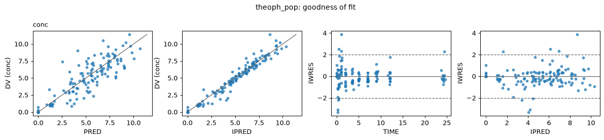
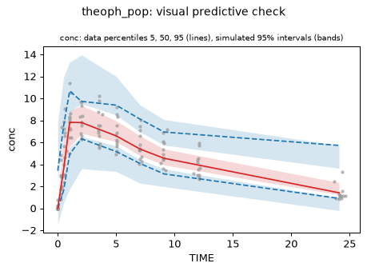
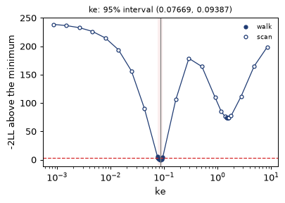
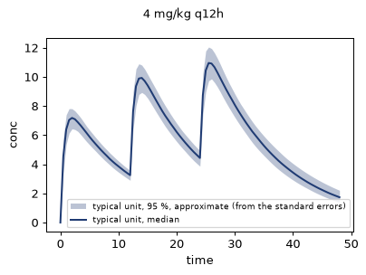

# Quickstart: a population PK fit

Theophylline, an oral bronchodilator, in 12 subjects (R's `Theoph` data): one dose each, then
11 concentrations over 24 hours. The files of this page are in the repository's
`docs/examples` folder: `theoph.csv` and `theoph_pop.tq`; `quickstart_population.py` runs
the whole page.

## The data

```text
"Subject","Wt","Dose","Time","conc"
1,79.6,4.02,0,0.74
1,79.6,4.02,0.25,2.84
1,79.6,4.02,0.57,6.57
...
```

One row per measurement; the dose (mg/kg) is a column, not a row of its own. That is R's
layout; the NONMEM layout (dose rows with `AMT`, `EVID`) is read too, see
[the data](../guide/data.md).

## The model and the fit, in one file

`theoph_pop.tq`:

```text
# One-compartment model with first-order absorption, fitted to R's Theoph data
model theoph
param ka=1.6, CL=0.04, ke=0.086
d_t(depot) = -ka*depot
d_t(centr) = ka*depot - ke*centr
observable conc = centr*ke/CL

fit theoph_pop
data "theoph.csv" with ID=Subject, TIME=Time, DV=conc
unit ID
doses Dose at t=0 into depot
observe conc = DV

estimate ka ~ lognormal(median=1.5, sdlog=0.5)
estimate CL ~ lognormal(median=0.04, sdlog=0.5)
estimate ke = 0.08
error conc ~ additive(1)

method laplace
```

Above the `fit` line is an ordinary TenQSP model. Below it, line by line:

| Line | Means |
|---|---|
| `data "theoph.csv" with ID=Subject, TIME=Time, DV=conc` | the data, with the file's own column names mapped to the standard ones (as NONMEM's `$INPUT`) |
| `unit ID` | the rows of one subject belong together; parameters can vary between units |
| `doses Dose at t=0 into depot` | each subject's dose is in the column `Dose`, given at time 0 into `depot` |
| `observe conc = DV` | the model's observable `conc` is what `DV` measures |
| `estimate ka ~ lognormal(median=1.5, sdlog=0.5)` | ka varies between subjects, lognormally; its median and its sdlog are estimated, starting from 1.5 and 0.5 |
| `estimate ke = 0.08` | ke is one value for every subject, estimated from 0.08 (on the log scale, so it stays positive) |
| `error conc ~ additive(1)` | the residual error: normal, SD estimated from 1 |
| `method laplace` | the population fit by the Laplace approximation (FOCE-I) |

## Read it and look before fitting

```python
import tenqsp_fit as tf

problem = tf.load("theoph_pop.tq")
print(problem.summary())
```

```text
theoph_pop: model theoph (2 states), data "theoph.csv": 12 units, 132 observations, 12 doses
units      ID: 12 units
links      conc <- DV (all rows)   132 rows, 12 units
doses      column Dose at t=0 -> depot   12 doses (one per unit)
errors     conc ~ additive(1)   (sd = a)
varying    ka ~ lognormal(median=1.5, sdlog=0.5)
           CL ~ lognormal(median=0.04, sdlog=0.5)
estimated  6: ka.median ka.sdlog CL.median CL.sdlog ke conc.additive
scales     log scale: ka.median ka.sdlog CL.median CL.sdlog ke conc.additive
one value  ke ~ lognormal(median=0.08, sdlog=0)
fixed      none
from model none
formulas   none
method     laplace (population, FOCE-I)
options    rtol 1e-6 (default), starts 1 (default), seed 0 (default), maxiter 200 (default), checks full (default)
```

Every link, dose route, estimated quantity, scale and default is listed. Nothing is fitted
yet: this is the place to catch a wrong link or a misread column.

## Fit

```python
result = tf.fit(problem)
```

While it runs, a few lines show the iteration, the best −2LL so far and the current values
(in a notebook, live plots of the same). Ctrl-C stops the fit and keeps what it has. This
fit takes about 50 seconds, of which about 15 compile the model.

```python
print(result)
```

```text
theoph_pop: method laplace (BFGS, FOCE-I), converged; -2LL 353.9837 (132 measurements, 12 units)
starts: 1; 1 at the best fit (within 0.1); redrawn 0; failed runs during the fit 0; 40 s

quantity                  estimate         SE  RSE %   95 % CI                 also
ka.median                   1.6195     0.3207   19.8   (1.099, 2.388)
ka.sdlog                   0.65643       0.15   22.9   (0.4194, 1.027)         cv 73.4 %, var 0.4309
CL.median                 0.039544   0.002353   5.95   (0.03519, 0.04444)
CL.sdlog                   0.16751    0.03643   21.7   (0.1094, 0.2566)        cv 16.9 %, var 0.02806
ke                        0.084964   0.004342   5.11   (0.07687, 0.09392)
conc.additive              0.70777    0.04815    6.8   (0.6194, 0.8087)

shrinkage (1 - SD of the units' scores): ka 0.8 %, CL -0.7 %

doctor: 3 notes
note     determination: condition number of the curvature 39.1; no ridge, every quantity determined within a factor 10.
note     optima: one start: other optima were not looked for.
         what to do: options starts=8 looks from 8 starts.
note     tolerance check: at rtol 1e-08 the -2LL changes by 2.2e-05 and the estimates by less than 0.001 SE; rtol 1e-06 is enough.
```

How to read it:

- **−2LL** is minus twice the log-likelihood, including the constant n log 2π (NONMEM's
  objective function value leaves the constant out: OFV = −2LL − n log 2π).
- `ka.median` is the typical subject's ka (NONMEM's THETA); `ka.sdlog` is the SD of log ka
  between subjects, shown also as a CV and as NONMEM's variance (OMEGA). The 95 % intervals of
  positive quantities are symmetric on the log scale, where they were estimated.
- **Shrinkage** near 0 means each subject's own estimate is informed by its own data.
- **The doctor** ran at the end of the fit. Here it found nothing wrong: no ridge, and a
  tighter solver tolerance changes nothing that matters. It notes that one start cannot show
  other optima.

These estimates agree with R's `nlme` fit of the same model to within 2 % (the two methods
stop at slightly different points; tenqsp-fit's −2LL is the lower).

## Each subject

```python
result.individual().head(4)
```

```text
   unit     z(ka)     z(CL)        ka        CL        ke
0     1 -0.195645 -2.137339  1.424331  0.027643  0.084964
1     2  0.418646  0.043821  2.131740  0.039835  0.084964
2     3  0.545603  0.141746  2.317006  0.040494  0.084964
3     4 -0.439296 -0.401549  1.213810  0.036971  0.084964
```

`z(ka)` is the subject's normal score (NONMEM's ETA divided by its SD); `ka` is the subject's
value.

## Goodness of fit and the VPC

```python
result.plot_gof()
```



Observations against the population (PRED) and individual (IPRED) predictions, and the
individual weighted residuals (IWRES) against time and prediction.

```python
v = result.vpc()        # 200 simulated studies with the same design
v.figure
```



The data's 5th, 50th and 95th percentiles over the bands of the same percentiles in studies
simulated from the fit: new subjects drawn from the estimated distributions, with residual
error, at the data's doses and times.

## A profile likelihood

```python
prof = result.profile("ke")
prof.plot()
```

```text
<Profile of ke: estimate 0.08496, 95% interval (0.07669, 0.09387), 36 points; cut-off 3.84 (chi-square, 1 df)>
```



ke is held at values on each side of its estimate and everything else refitted; the
interval is where −2LL stays within the cut-off. Beyond the walk the profile scans out to a
hundredth and a hundred times the estimate, in case the data allow a second, separate range
of values (see [profiles](../guide/results.md#profile-likelihood)). Here the scan finds a
second dip near ke = 1.5: the flip-flop fit of a one-compartment model with absorption, where
ke takes the value of ka and ka the value of ke. It lies about 75 above the minimum, far
outside the cut-off, so the interval is one piece and agrees with the one from the standard
error, (0.0769, 0.0939). This takes about 3 minutes; `scan=False` leaves out the scan.

## A new regimen

```python
import numpy as np
import tenqsp as tq

dose = tq.bolus("depot", 4.0, times=[0, 12, 24])          # 4 mg/kg every 12 h, three doses
pred = result.predict(regimen=dose, times=np.linspace(0, 48, 97), outputs=["conc"],
                      name="4 mg/kg q12h", n=200)
pred.plot()
```



The typical subject's concentration, with an interval from 200 sets of estimates drawn from
their standard errors and correlations. After `laplace` and `optimize` this interval is
labelled approximate; after `nuts` it is a posterior interval.

## Keep it

```python
print(result.passport())   # the run, each quantity, the doctor, numerical checks, TenQSP's reports
result.save("theoph_run")  # tables, plots, passport, the problem text and data, versions and hashes
```

The [passport](../guide/doctor.md) is one document per fit: what was run (data and model
hashes, versions, options), how well each quantity is determined, the doctor's findings and
TenQSP's own checks of the model.

## The same fit in Python

Every line of the fit text is one call:

```python
import tenqsp as tq
import tenqsp_fit as tf

m = tq.load("theoph_pop.tq")               # reads the model part
p = tf.Problem(m, name="theoph_pop")
p.data("theoph.csv", ID="Subject", TIME="Time", DV="conc")
p.unit("ID")
p.doses(column="Dose", at=0, into="depot")
p.observe("conc", "DV")
p.estimate("ka", tf.lognormal(median=1.5, sdlog=0.5))
p.estimate("CL", tf.lognormal(median=0.04, sdlog=0.5))
p.estimate("ke", 0.08)
p.error("conc", tf.additive(1))
p.method("laplace")

print(p.to_text())                         # the fit part as text, as in the file
result = tf.fit(p)
```
