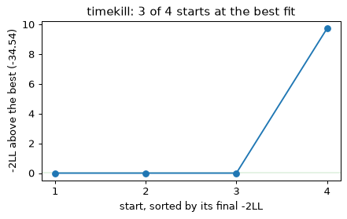
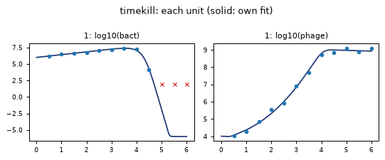
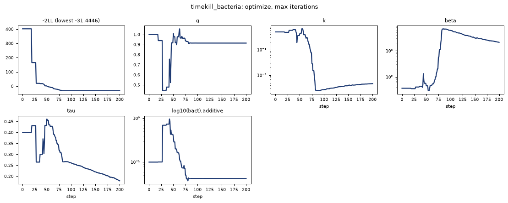

# Quickstart: a QSP model with a structured population

Bacteria in a flask with a lytic phage, counted every half hour for 6 hours. An infected
cell bursts after a delay, so the infected cells are tracked by their **infection age**: the
time since the phage entered. The data are synthetic, simulated from the model itself, so
the true values are known. The files are in the repository's `docs/examples` folder:
`infection_age.tq`, `infection_age_bacteria.tq`, `timekill.csv` (made by `make_timekill.py`);
`quickstart_qsp.py` runs the whole page in about 15 minutes.

This page shows a fit of a model with a structured population, and then what the doctor says
when the data cannot determine the parameters.

## The model

```text
model infection_age
axis a in [0, 2] n=100 kind=one_way
param g=1, k=5e-8, beta=50, tau=0.5, s=0.05
param K=1e9, delta=0.1, hmax=30
h(a) = hmax/(1 + exp(-(a - tau)/s))
field I(a)
d_t(S) = g*S*(1 - S/K) - k*S*P
d_t(I) = -d_a(I) - h*I        using sharp
    at a=0: I = k*S*P
    at a=2: outflow
d_t(P) = beta*int_a(h*I) - k*S*P - delta*P
S(0) = 1e6
P(0) = 1e4
observable bact = S + int_a(I)
observable phage = P
```

| Symbol | Means | True value |
|---|---|---|
| `S` | uninfected bacteria (per mL), growing logistically at rate `g` | g = 1 /h |
| `P` | free phage (per mL), adsorbing at rate `k` per bacterium | k = 5×10⁻⁸ mL/h |
| `I(a)` | infected cells by infection age `a` (h); newly infected cells enter at age 0 | |
| `h(a)` | the bursting hazard: near 0 before age `tau`, then `hmax` | tau = 0.5 h |
| `beta` | phage released per burst | beta = 50 |
| `bact` | what a plate count sees: uninfected and infected cells | |

This is an ordinary [TenQSP](https://tenqsp.github.io/tenqsp/) model, a partial differential
equation in infection age next to ordinary ones; TenQSP turns it into 102 ordinary
differential equations and gives exact derivatives of every output.

## The data and the fit

`timekill.csv` holds the log10 counts of bacteria and phage, one row per measurement, with
`DVID` saying which. Bacteria at or below 100 per mL (log10 2) are reported as below the limit
(`BLQ` 1):

```text
TIME,DV,DVID,BLQ
0.5,6.217,bact,0
0.5,4.038,phage,0
1.0,6.478,bact,0
...
```

The fit part of `infection_age.tq`, after the model:

```text
fit timekill
data "timekill.csv"
observe log10(bact) = DV where DVID == "bact"
observe log10(phage) = DV where DVID == "phage"
censor log10(bact) where BLQ == 1 below 2

estimate g = 0.8, k = 1e-7, beta = 30, tau = 0.4
error log10(bact) ~ additive(0.2)
error log10(phage) ~ additive(0.2)

method optimize
options starts=4 seed=1 rtol=1e-8
```

| Line | Means |
|---|---|
| `observe log10(bact) = DV where DVID == "bact"` | the rows with `DVID` bact measure the log10 of the observable `bact` |
| `censor log10(bact) where BLQ == 1 below 2` | those rows say only that the count was at or below 10²: they enter the likelihood as a probability (the M3 method), not as a value |
| `estimate g = 0.8, ...` | four parameters estimated, from these starting values; the others stay at the model's values |
| `error ... ~ additive(0.2)` | normal error on the log10 scale, its SD estimated, one per kind of measurement |
| `method optimize` | maximum likelihood for one experiment |
| `options starts=4 seed=1 rtol=1e-8` | four starts (the given values and three drawn around them), a tighter solver tolerance, for counts that span six orders of magnitude |

```python
import tenqsp_fit as tf

result = tf.fit(tf.load("infection_age.tq"))
print(result)
```

```text
timekill: method optimize (BFGS), converged; -2LL -34.5421 (24 measurements)
starts: 4; 3 at the best fit (within 0.1); redrawn 0; failed runs during the fit 0; 534 s

quantity                  estimate         SE  RSE %   95 % CI                 also
g                          0.98104    0.03524   3.59   (0.9143, 1.053)
k                       4.7292e-08  1.519e-08   32.1   (2.52e-08, 8.875e-08)
beta                        36.579      4.911   13.4   (28.12, 47.59)
tau                        0.41603    0.06882   16.5   (0.3008, 0.5753)
log10(bact).additive      0.095006    0.02395   25.2   (0.05797, 0.1557)
log10(phage).additive      0.11567    0.02486   21.5   (0.07591, 0.1762)

doctor: 1 warning, 3 notes
warning  several optima: the starts ended at 2 different fits: -2LL -34.5421 (3 starts), -2LL -24.8131 (1 start); the best is reported.
         what to do: if few starts reached the best, run more starts (options starts=); compare the fits in result.starts.
note     determination: condition number of the curvature 1.56e+04; no ridge, every quantity determined within a factor 10.
note     tolerance check: at rtol 1e-10 the -2LL changes by 1.3e-06 and the estimates by less than 0.001 SE; rtol 1e-08 is enough.
note     gradient check: exact gradients agree with differences (at rtol 1e-10) to 0.054 % (3 directions).
```

The fit takes about 9 minutes. The estimates are near the true values (g 1, k 5×10⁻⁸, beta
50, tau 0.5), each within two standard errors; with 24 measurements of one experiment, a 95 %
interval that just misses the true value, as beta's does here, happens one time in twenty.

**The doctor** warns of several optima: three starts ended at the best fit, the fourth at one
about 10 worse in −2LL. The best is reported, and with only one start this fit could have
stopped at the worse one without a word. `result.starts` lists each start; the waterfall shows
the same:

```python
result.plot_waterfall()
```



```python
result.plot_individual()
```



The bacteria rise, then crash as the phage multiply. The three counts below the limit are
drawn as crosses at the limit; the model only has to lie below them. Below about 10⁻⁶ per mL
the model's counts are held up by a smooth floor at the solver's absolute tolerance (the
summary lists it as `near zero`), so the curve levels off at −6 instead of falling to minus
infinity.

## What bacteria counts alone cannot tell

Phage counts cost an extra plate per sample. What if only the bacteria had been counted?
`infection_age_bacteria.tq` is the same model and data, with the phage rows ignored, and one
start, near the estimates of the first fit:

```text
fit timekill_bacteria
data "timekill.csv"
observe log10(bact) = DV where DVID == "bact"
ignore DV where DVID == "phage"
censor log10(bact) where BLQ == 1 below 2

estimate g = 1, k = 5e-8, beta = 37, tau = 0.4
error log10(bact) ~ additive(0.1)

method optimize
options rtol=1e-8
```

```python
bacteria = tf.fit(tf.load("infection_age_bacteria.tq"))
print(bacteria)
```

```text
timekill_bacteria: method optimize (BFGS), max iterations; -2LL -31.4446 (12 measurements)
starts: 1; 1 at the best fit (within 0.1); redrawn 0; failed runs during the fit 0; 214 s

quantity                  estimate         SE  RSE %   95 % CI                 also
g                          0.91462    0.01732   1.89   (0.8813, 0.9492)
k                       4.6866e-10  5.054e-10    108   (5.661e-11, 3.88e-09)
beta                        2109.7       2564    122   (194.8, 2.285e+04)
tau                        0.17919    0.04893   27.3   (0.1049, 0.306)
log10(bact).additive      0.042171   0.009942   23.6   (0.02657, 0.06694)

doctor: 2 problems, 4 notes
problem  convergence: the fit ended with status 'max iterations': the estimates are where it stopped, not a minimum.
         what to do: more iterations (options maxiter=), better starts, or bounds; check result.plot_trace().
problem  ridge: beta and k are not determined apart, only beta^0.88 x k is (curvature ratio 8.3e-04).
         what to do: measure what tells them apart, write a prior on some of them, or estimate the determined combination (a formula after fit).
note     determination: condition number of the curvature 1.46e+06.
note     optima: one start: other optima were not looked for.
         what to do: options starts=8 looks from 8 starts.
note     tolerance check: at rtol 1e-10 the -2LL changes by 9.4e-07 and the estimates by less than 0.001 SE; rtol 1e-08 is enough.
note     gradient check: exact gradients agree with differences (at rtol 1e-10) to 0.37 % (3 directions).
```

The fit starts near the right answer and leaves it: by step 90 it fits the bacteria counts
as well as it ever will, with k about 200 times too small and beta about 130 times too large.
For the last 110 steps it walks along a valley, k rising and beta falling together (to
4.7×10⁻¹⁰ and 2110, still 100 and 40 times off), while −2LL changes by less than 0.1. It stops at the iteration limit, still walking. **The
doctor** says why: k and beta are on a ridge. Bacteria counts determine one
combination, about beta^0.88 × k, how fast phage kill, and not how much of that comes from
infecting (k) and how much from bursting (beta). More iterations would not help; the data
cannot settle it. What does help is what the doctor lists: measure something that tells them
apart (the phage counts of the first fit), write a prior on one of them (for example, the
burst size from a one-step growth experiment), or report the combination.

```python
bacteria.plot_trace()
```



The path of the fit: −2LL flat after step 90 while k and beta (on log axes) move in
opposite directions, and tau drifts with them: the delay to bursting trades off against them
too, more weakly.

## What to take from this

- A structured population is fitted like any other model: the fit text does not change.
- **Several starts** find what one start can miss; the doctor reports how many reached the
  best fit.
- **The doctor's ridge** tells which quantities the data determine and which only in
  combination, before anyone reports an estimate of k with an RSE of 108 %.
